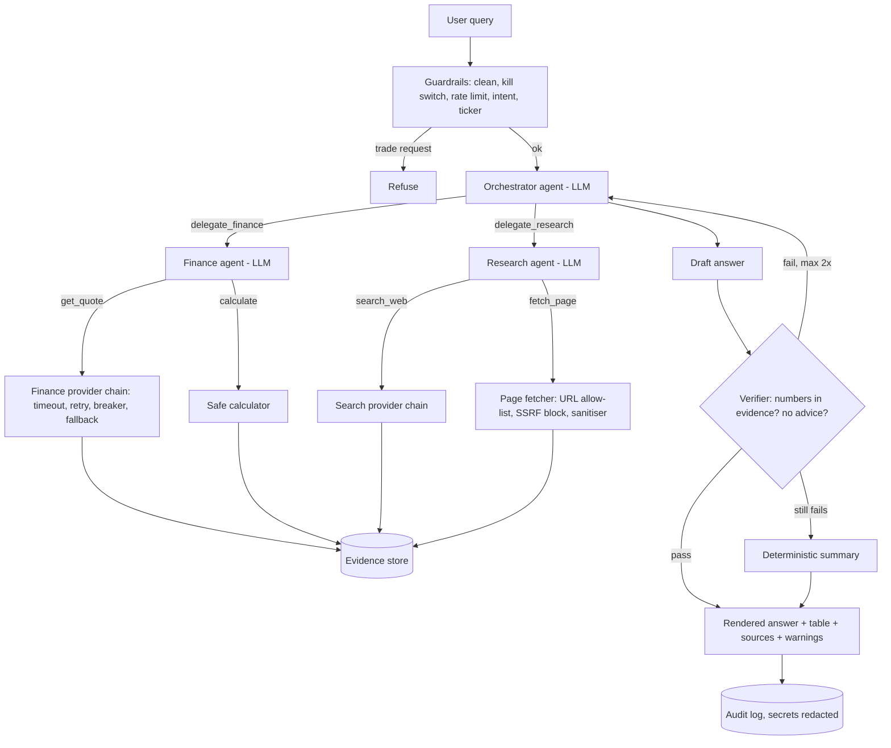

# Architecture

## Safety nets
- LLM unreachable or crashes -> whole request falls back to deterministic pipeline (visible warning).
- A tool never called by a weak model -> orchestrator calls it directly (visible warning).
- Provider down -> retry, breaker, fallback provider, else DEGRADED/UNAVAILABLE. Never fake data.

## File map
| File | Role |
|---|---|
| `finagent/agentic.py` | Agent loop, tools, evidence store, orchestrator with reflection |
| `finagent/llm_clients.py` | OllamaClient (real), ScriptedLLM (offline test double) |
| `finagent/agents.py` | Pipeline mode, rendering, shared orchestration base |
| `finagent/guardrails.py` | Intent, ticker, injection filter, plausibility, number verifier |
| `finagent/resilience.py` | Timeout, retry, breaker, cache, rate limit, provider chain |
| `finagent/providers/` | yfinance, DuckDuckGo, MCP (optional), demo data |
| `finagent/audit.py` | Redacted JSONL audit log |
| `app.py` | Streamlit UI with agent trace |
| `evaluate.py` | Fixed 10-case matrix, both modes |
| `tests/` | 25 tests |
